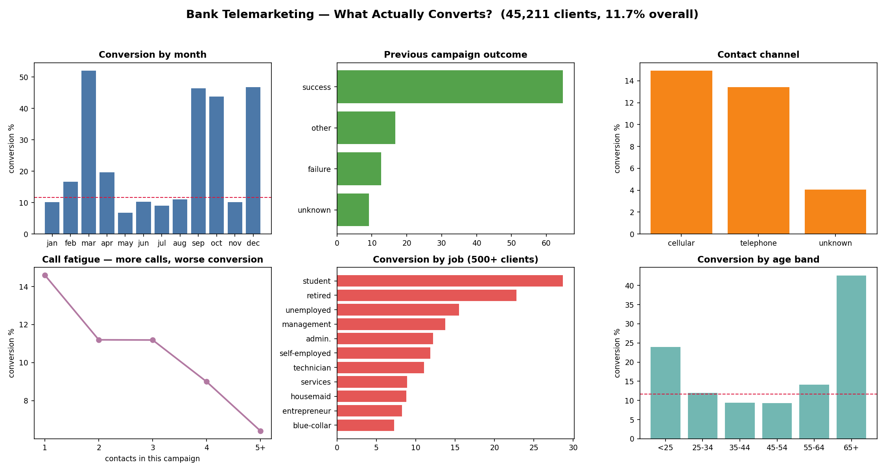

# Bank Telemarketing Conversion Analysis

**What actually makes a bank's phone campaign convert?** An end-to-end analysis of 45,211 real client contacts from a Portuguese bank's term-deposit telemarketing campaigns (UCI Bank Marketing dataset, May 2008 – Nov 2010) — using SQL for the business questions, Python for segment analysis and modelling, and a 6-panel dashboard for the story.



## Headline numbers

| | |
|---|---|
| Clients contacted | 45,211 |
| Term-deposit subscriptions | 5,289 |
| **Overall conversion** | **11.70%** |
| Best segment (previous campaign = success) | 64.7% conversion |
| Worst use of effort (May mega-campaign) | 13,766 calls at 6.7% |

## Key findings

1. **A previous "yes" is the strongest signal there is.** Clients whose last campaign ended in *success* converted at **64.7%** (978 of 1,511) — vs 9.2% for clients never contacted before. Anyone contacted in an earlier campaign converted at 23.1%, vs 9.2% for first-time contacts. The bank's best call list is its own history.
2. **Volume is not a strategy.** May swallowed **13,766 contacts — 30% of all effort — and converted at just 6.7%**, the worst month. The high-rate months (Mar 52.0%, Dec 46.7%, Sep 46.5%, Oct 43.8%) each had under 750 contacts: small, targeted lists, not a volume blast. (Rates on a few hundred clients are noisier — flagged, not hidden.)
3. **29% of calls go to numbers nobody can even classify.** Contact type was "unknown" for 13,020 clients, and that group converted at **4.1%** — vs 14.9% on cellular and 13.4% on telephone. Cleaning up the contact data is worth more than more dialling.
4. **Call fatigue is real and measurable.** First contact in a campaign: 14.6% conversion. By the 5th+ contact: **6.4%**. Every extra call buys less and annoys more — a 3-contact cap would free up thousands of calls for better segments.
5. **Debt-free clients say yes.** Clients with neither a housing loan nor a personal loan converted at **18.2%**; clients carrying both converted at **6.1%**. Existing debt is a targeting filter, not just a credit fact.
6. **The edges of the age curve convert.** 65+ clients: **42.6%**; under-25s: 24.0%; the 35–54 middle: ~9.4%. By job, students (28.7%) and retired clients (22.8%) lead; blue-collar clients trail at 7.3%.
7. **Long calls "predict" conversions — and that's a trap.** Subscribers' calls averaged 537 seconds vs 221 for non-subscribers. But call duration is only known *after* the call, so using it to pick who to call is target leakage. The model below deliberately excludes it.

## The model (honest version)

Logistic regression on **pre-call features only** (age, job, marital status, education, balance, existing loans, contact channel, month, previous-campaign history — never duration): **ROC-AUC 0.773** on 11,303 held-out clients (baseline 0.500). Good enough to rank a call list, not good enough to skip the segment thinking above — which is exactly what a call-list model should be.

## Recommendations

- **Call yesterday's happy customers first** — the previous-success segment is small (1,511 clients) but converts at 5.5× the average.
- **Fix the "unknown contact" bucket** (29% of all records) before buying more call volume.
- **Cap contacts per campaign at 3** and reallocate the freed capacity from May-style volume pushes to the high-converting segments.
- **Screen out double-loan holders** for deposit campaigns, and build separate lists for students/retired segments instead of one blended list.

## How it was built

| Step | Tool | What happened |
|---|---|---|
| Data | UCI Bank Marketing (`bank-full.csv`, in `data/`) | 45,211 rows × 17 columns; 0 missing values, 0 duplicates |
| Cleaning | Python / pandas | `pdays = -1` decoded as "never contacted"; age bands and contact-count groups derived |
| Business questions | **SQL** (SQLite, `sql/queries.sql`) | 8 questions: overall rate, month, channel, previous outcome, call fatigue, job, existing loans, repeat-contact economics |
| Analysis | Python / pandas | Segment conversion tables exported to `outputs/` |
| Modelling | scikit-learn | Logistic regression, pre-call features only, held-out ROC-AUC |
| Reporting | matplotlib | 6-panel dashboard (`assets/dashboard.png`) |

*Excel / Power BI equivalents: the SQL segment queries are pivot tables; the dashboard is a Power BI page (bar/line visuals + a card for the 11.70% headline); the fatigue curve is a line chart over a grouped COUNTIF/SUMIF table.*

## Run it yourself

```bash
pip install pandas matplotlib scikit-learn
python3 analysis.py
```

This rebuilds `bank.db` (SQLite), runs every query in `sql/queries.sql`, rewrites the tables in `outputs/`, and regenerates the dashboard.

## Data source & honesty notes

- Moro, Cortez & Rita (2014), *A Data-Driven Approach to Predict the Success of Bank Telemarketing*, Decision Support Systems 62:22–31. Dataset: [UCI Machine Learning Repository — Bank Marketing](https://archive.ics.uci.edu/dataset/222/bank+marketing) (CC BY 4.0).
- Small-month conversion rates (Mar/Dec/Sep/Oct) rest on 214–738 contacts each — directionally interesting, not precise.
- Data is from 2008–2010 campaigns; the *patterns* (history, fatigue, data quality) are the point, not the exact percentages.
